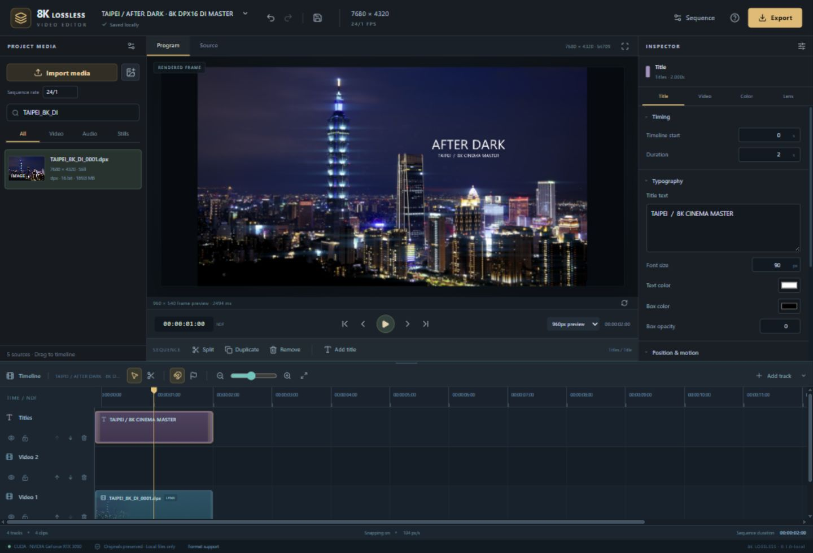
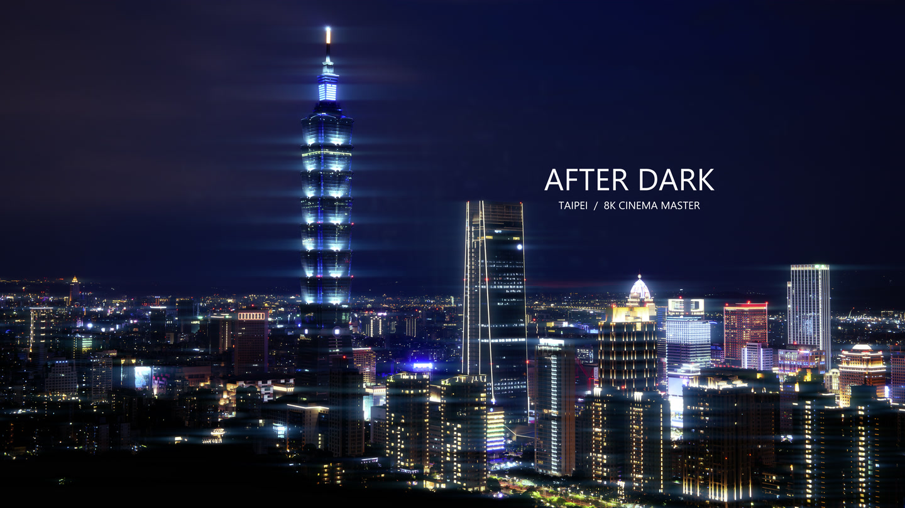

# 8K Lossless Video Editor

## Cut in 8K. Shape the image. Deliver a verified cinema master.

**Created by [Taylor Kalin](https://github.com/Teylersf)** · **Free & open source** · **Apple Silicon / NVIDIA CUDA / CPU**

A local editing workspace for the whole creative pass: build the cut, layer
images and titles, shape color and anamorphic lens character, mix the sound,
and deliver a master in the format your next step needs.

**Native 8K timelines. 16-bit RGB masters. Float EXR. Multitrack audio.
24 export profiles. Your footage stays on your computer.**

[**Windows EXE · 2.10 GB**](https://github.com/Teylersf/8k-lossless-video-editor/releases/download/v0.1.0-beta.1/8KLosslessVideoEditor-0.1.0-beta.1-win-x64.exe) ·
[**Mac DMG · macOS 26.6.2+**](https://github.com/Teylersf/8k-lossless-video-editor/releases/download/v0.1.0-beta.1/8KLosslessVideoEditor-0.1.0-beta.1-mac-arm64.dmg) ·
[Checksums & source packages](https://github.com/Teylersf/8k-lossless-video-editor/releases/tag/v0.1.0-beta.1)

[Explore the formats](docs/FORMAT_SUPPORT.md) · [See the verification](docs/VALIDATION.md) ·
[Browse the source](https://github.com/Teylersf/8k-lossless-video-editor) ·
[Report an issue](https://github.com/Teylersf/8k-lossless-video-editor/issues)



*Actual editor workspace: an 8K DPX16 digital-intermediate workflow using
cropped/downsampled high-resolution JPEG still artwork. Sixteen-bit describes
the master delivery precision. [Artwork preparation and credits](#showcase-artwork).*

Artwork: **etonline**, [*Taipei Skyline at Night 20210710*](https://commons.wikimedia.org/wiki/File:Taipei_Skyline_at_Night_20210710.jpg),
[CC BY-SA 2.0](https://creativecommons.org/licenses/by-sa/2.0/); adapted through
crop/downsampling, color/lens treatments and titles. Photo-derived showcase
images and demo media use CC BY-SA 2.0; application code uses GPL-3.0-or-later
with the [scoped PyTorch runtime permission](LICENSE-EXCEPTION).

## From an 8K timeline to a DPX16 digital intermediate

Build a native **7680×4320 UHD 8K** or **8192×4320 DCI 8K** sequence. Make the
edit, composite an overlay, add a title and finish the color. Choose
**DPX 16-bit image sequence** to deliver numbered cinema/interchange frames,
a float32 PCM mix and a timeline manifest in one ZIP archive.

The same project can become a verified **FFV1 RGB16 master**, a **linear float
EXR sequence**, reversible **JPEG 2000**, a ProRes/DNxHR editing file, or an
H.264/HEVC/AV1 delivery encode. Select the picture precision, codec and audio
format that fit the next step in your workflow.

**Verified in the actual editor:** the showcased **48-frame, 7680×4320 DPX16
master at 24 fps** passed independent decoded RGB16 verification for every
frame, ZIP integrity and source-file checks. Its 9.56 GB archive includes the
processed float32 PCM mix. [See the public proof.](docs/validation/cinema-8k-dpx16.json)

**Verification is part of the render.** Lossless picture exports are decoded
again and compared with the rendered samples before publication. Native 8K
proofs on **NVIDIA RTX 3090 and Apple M4** have passed RGB16 recovery, exact
float32 audio and effects/title/overlay rendering; NVIDIA's codec-lossless
YUV10 path also passed. [Read the measured scope and results.](docs/VALIDATION.md)



*A viewing JPEG of the actual 8K DPX16 output, with the same artwork credit
and license as the hero above. The verification checks the DPX samples.*

## A focused workspace with room to create

| Build the cut | Finish the picture | Deliver the master |
| --- | --- | --- |
| Multitrack video, audio and titles | Exposure, contrast, saturation and temperature | Native UHD/DCI 8K project rasters |
| Drag, trim, split, duplicate and reorder | Crop, position, scale, rotation and flips | Verified RGB16 FFV1, reversible JPEG 2000 and uncompressed RGB16 |
| Snapping, frame stepping and timeline zoom | Opacity, compositing and clip-local keyframes | PNG16, TIFF16, DPX16 and float EXR sequences |
| Markers, track names, mute and edit locks | Anamorphic streaks, halation, bloom, ghosts and grain | ProRes, DNxHD/DNxHR, MXF, CineForm and delivery profiles |
| Undo/redo, local saves and project JSON | Blue/amber flare color and oval focus falloff | Render progress, cancellation and verified downloads |

### See the program you are actually making

The **Program** viewer renders your timeline's current edits, compositing and
effects. Press Play to create a full-timeline playback proxy. Switch to
**Source** to inspect the source viewing proxy. Change the edit and the old
program playback is invalidated, so an earlier render cannot masquerade as
the new cut.

### Make light part of the look

Give highlights a horizontal anamorphic streak, move the coating color from
cool blue to warm amber, and combine bloom, halation, reflected ghosts,
chromatic separation, vignette and animated grain. Optional oval focus
falloff uses an adjustable artistic focus band. Color, lens and transform
controls live beside the selected clip, with linear animation for position,
scale, opacity and volume.

### Give the soundtrack its own timeline

Layer audio clips, trim and move them, adjust gain, animate volume, and build
fades or overlaps. Work at **44.1, 48 or 96 kHz**, with **mono, stereo, 5.1 or
7.1** project layouts. Lossless-master paths retain the processed mix as
**float32 PCM**; delivery and broadcast profiles report their chosen audio
conversion. Waveforms are calculated from decoded audio.

## Bring the formats your workflow uses

### Cinema, editorial and broadcast

**ProRes Proxy · LT · 422 · HQ · 4444 · XQ**
**DNxHD · DNxHR HQX · DNxHR 444 · CineForm · JPEG 2000**

Import supported variants in **MOV, MXF, AVI, MJ2, GXF, MPEG program streams,
MPEG-TS, MTS and M2TS**. Work with individual **DPX**, **EXR**, **TIFF** and
**PNG** images or explicit image sequences. Sixteen-bit and scene-linear float
sources use native decoder paths, with separate display posters.

### Everyday video and audio

**MOV · MP4 · M4V · 3GP · MKV · WebM · AVI · NUT · WMV · ASF · FLV · MPEG · VOB**
**H.264/AVC · HEVC/H.265 · AV1 · VP8 · VP9 · FFV1 · MJPEG · uncompressed video**

Audio families include **WAV/BWF/RF64/Wave64, AIFF, FLAC, ALAC/M4A, MP3,
AAC, Opus and Ogg/Vorbis**. Still-image families also include **JPEG,
JPEG-LS, JPEG XL, BMP, TGA and WebP**.

The in-app **Format support** panel checks installed decoders and encoders.
Actual import/export also checks the file variant, raster, timing and hardware.
[The full format guide](docs/FORMAT_SUPPORT.md) explains the exact paths.

## All 24 export profiles

| Workflow | Profiles |
| --- | --- |
| **Verified master / original** | Lossless RGB16 FFV1; NVIDIA HEVC codec-lossless; original whole-file packet copy; uncompressed RGB16; reversible JPEG 2000 RGB16 |
| **Delivery** | HEVC/H.265; H.264/AVC; AV1 |
| **ProRes editorial** | ProRes Proxy; ProRes 422 LT; ProRes 422; ProRes 422 HQ; ProRes 4444; ProRes 4444 XQ |
| **Avid editorial** | DNxHR HQX 10-bit; DNxHR 444 10-bit; DNxHD 1080p broadcast |
| **Broadcast / interchange** | MXF OP1a / DNxHR HQX; MXF MPEG-2 4:2:2 50 Mb/s; CineForm RGB 12-bit |
| **Image finishing** | PNG16 sequence; TIFF16 sequence; DPX16 sequence; OpenEXR float sequence |

[See every profile's container, pixel format and audio contract →](docs/FORMAT_SUPPORT.md#all-24-export-profiles)

## Designed for your workstation

| Apple Silicon | NVIDIA CUDA | CPU / local operation |
| --- | --- | --- |
| Native ARM64 Python and Metal/MPS effects | CUDA effects and probed NVENC output | CPU fallback for supported processing |
| VideoToolbox delivery when supported | Explicit HEVC target-YUV10 codec-lossless mode | Local browser UI at `127.0.0.1:8770` |
| FFmpeg-full for HDR viewing and media tools | Requested geometry is tested before hardware success is claimed | No cloud account, subscription or media relay |

**Your source files stay intact.** Imports have SHA-256 records. Projects and
render snapshots refer to private media IDs. There are no runtime remote fonts,
analytics, Vercel services or automatic uploads to a cloud editor. Save project
JSON, reopen local projects and relink sources when moving to another machine.

This is **0.1.0-beta.1**, free application source by Taylor Kalin under
**GPL-3.0-or-later** with a [scoped PyTorch runtime permission](LICENSE-EXCEPTION).
Native 8K proofs include a 24-frame Apple M4 master, RTX 3090 master/effects
checks and the 48-frame DPX16 cinema showcase. These are offline integrity
results. Compositing, decoding and audio can use CPU even when a GPU is selected. The
[validation guide](docs/VALIDATION.md) keeps hardware receipts and limits explicit.

## Start creating

**Download the native app. Open your footage. Make your master.**

| Platform | Installer | Verified hardware / requirements |
| --- | --- | --- |
| **Windows / NVIDIA** | **[Download Windows EXE](https://github.com/Teylersf/8k-lossless-video-editor/releases/download/v0.1.0-beta.1/8KLosslessVideoEditor-0.1.0-beta.1-win-x64.exe)** · 2.10 GB | Windows x64; RTX 3090 tested. A compatible NVIDIA driver is needed for CUDA/NVENC. |
| **Apple Silicon Mac** | **[Download Mac DMG](https://github.com/Teylersf/8k-lossless-video-editor/releases/download/v0.1.0-beta.1/8KLosslessVideoEditor-0.1.0-beta.1-mac-arm64.dmg)** · 285 MB | **macOS 26.6.2+**; Apple M4 tested. |

The native packages include the editor and media engine—**no Python, Node.js
or Homebrew setup**. On Windows, run the installer for your user account. On
Mac, open the DMG and drag the app into Applications. Created by **Taylor Kalin**.

Both installed apps passed actual 8K export, native download and quit/reopen
checks. Successful exports show **Export verified and ready**, with their
complete processing notes available in a collapsed section.

**Beta signing:** the Windows build is unsigned; the Mac build uses ad-hoc
signing and is not notarized. The current DMG's OS requirement applies to the
bundled app; source setup requirements are listed separately below.

[All release assets, matching source archives and checksums](https://github.com/Teylersf/8k-lossless-video-editor/releases/tag/v0.1.0-beta.1)
· [Installed-app validation](docs/VALIDATION.md#installed-desktop-applications)

Prefer running from source? Expand your platform:

<details>
<summary><strong>Apple Silicon Mac — source setup</strong></summary>

Install native Python **3.13**, Node **22.12+ within 22.x**, and FFmpeg full.
Use macOS 15+ for the current supported Homebrew setup; pinned dependencies
require macOS 14+. Install Apple's command-line tools with
`xcode-select --install` if needed, then obtain [Homebrew](https://docs.brew.sh/Installation).

```bash
brew install python@3.13 node@22 ffmpeg-full
git clone https://github.com/Teylersf/8k-lossless-video-editor.git
cd 8k-lossless-video-editor
bash "SETUP MAC.command"
bash "START 8K LOSSLESS VIDEO EDITOR.command"
```

Open **http://127.0.0.1:8770**. To stop this editor:

```bash
bash "STOP 8K LOSSLESS VIDEO EDITOR.command"
```

Setup builds the interface and prepares `.venv-editor`; it does not start the
server. The wrappers select the keg-only `ffmpeg-full/bin` in their own PATH,
without global linking or uninstalling the regular FFmpeg package.
[Homebrew full formula](https://formulae.brew.sh/formula/ffmpeg-full) ·
[Apple PyTorch/MPS requirements](https://developer.apple.com/metal/pytorch/).

</details>

<details>
<summary><strong>Windows / NVIDIA — source setup</strong></summary>

Install Python **3.13** with its `py` launcher, Node **22.12+ within 22.x**, a
full FFmpeg/ffprobe build on PATH, and a working NVIDIA driver for CUDA/NVENC.

```powershell
git clone https://github.com/Teylersf/8k-lossless-video-editor.git
cd 8k-lossless-video-editor
py -3.13 setup_editor.py
py -3.13 launch.py
```

Or use **SETUP WINDOWS.cmd**, then **START 8K LOSSLESS VIDEO EDITOR.cmd**.
Use **STOP 8K LOSSLESS VIDEO EDITOR.cmd** to stop this editor. Setup targets
PyTorch **2.11.0 / CUDA 12.6** in `.venv-editor`. CPU setup is available with
`py -3.13 setup_editor.py --cpu`.
[Official PyTorch version instructions](https://pytorch.org/get-started/previous-versions/).

</details>

<details>
<summary><strong>Developer checks and local storage</strong></summary>

```bash
npm --prefix app ci
npm --prefix app run build
npm --prefix app run lint
npm --prefix app test
```

See [Python tests and verification](docs/VALIDATION.md) and the
[architecture](docs/ARCHITECTURE.md). Imports, projects and renders live in
ignored `data/`; local diagnostics live in ignored `out/`. Back up those folders
separately. The queue holds four active/queued jobs and runs one renderer at a
time. Cancellation targets owned workers. The separate Lens Studio on port
8766 is not started or stopped by this app.

</details>

## A clear finishing contract

- **Original packet copy** currently means one unchanged whole source file.
  **RGB16 lossless** preserves processed integer RGB samples.
  **NVENC codec-lossless** preserves target 10-bit YUV samples; RGB conversion
  can still change information. Delivery/mezzanine codecs are labeled separately.
- Rendering edits changes pixels and sound. Original source bytes remaining
  intact does not make a graded output identical to its source. RGB16 is not
  float EXR; ProRes 4444/XQ currently uses opaque 10-bit output without alpha.
- BRAW, RED R3D, ARRIRAW, Canon Cinema RAW, ProRes RAW and complete DCP/IMF
  packages need paths not implemented here. Individual supported MXF/JPEG 2000
  assets are different from a complete cinema package. ACEScg primaries support
  is not a full OCIO/ACES mastering pipeline.

The [format guide](docs/FORMAT_SUPPORT.md) gives the exact compatibility,
color and audio boundaries. Formats are installed capabilities, not a claim
that every variant or every profile supports 8K.

## Free software, built in the open

Created by **Taylor Kalin**. Explore the code, report a reproducible issue,
or help expand tested workflows through
[GitHub](https://github.com/Teylersf/8k-lossless-video-editor).

[GPL-3.0-or-later license](LICENSE) · [PyTorch runtime permission](LICENSE-EXCEPTION) ·
[Third-party licenses and source](docs/THIRD_PARTY.md) · [Provenance notices](NOTICE.md) ·
[Issues](https://github.com/Teylersf/8k-lossless-video-editor/issues) ·
[Releases](https://github.com/Teylersf/8k-lossless-video-editor/releases)

<a name="showcase-artwork"></a>

<details>
<summary><strong>Showcase artwork credit and preparation</strong></summary>

The hero artwork comes from etonline's
[*Taipei Skyline at Night 20210710*](https://commons.wikimedia.org/wiki/File:Taipei_Skyline_at_Night_20210710.jpg),
licensed [CC BY-SA 2.0](https://creativecommons.org/licenses/by-sa/2.0/).
The 12,000×8,000 JPEG original is cropped to 12,000×6,750 at vertical offset
900, then downsampled to 7680×4320. Demo edits add color/lens treatments and
titles. The photo-derived artwork, modified demo media and showcase imagery
are shared under CC BY-SA 2.0. These image credits do not change the
application source's GPL-3.0-or-later license or imply endorsement by the photographer.

</details>
