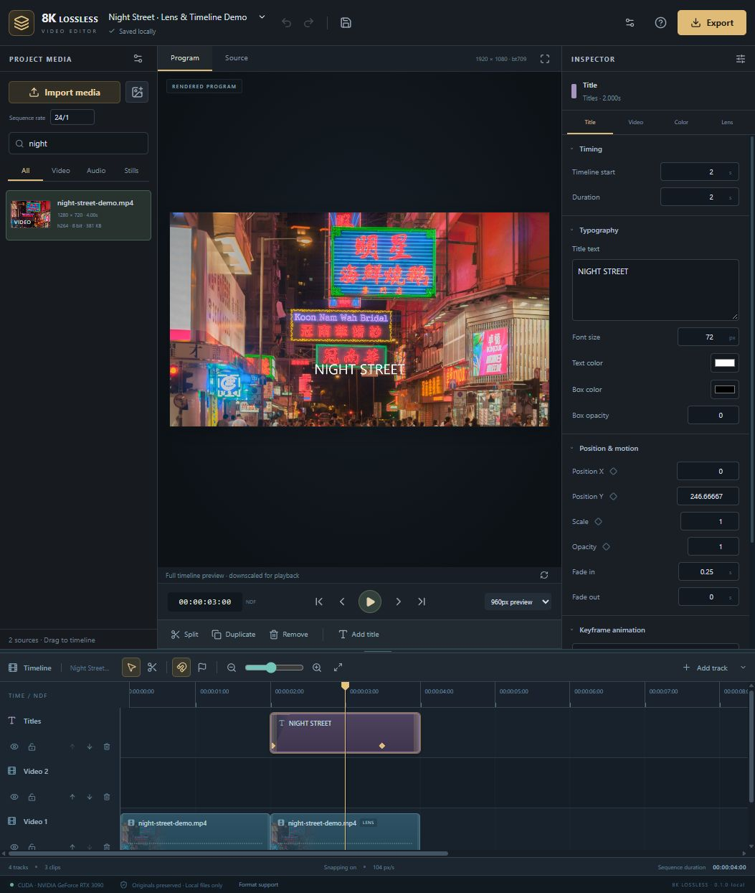

# 8K Lossless Video Editor

**A free, local timeline editor for Apple Silicon Mac, NVIDIA CUDA and CPU.**

Arrange video, images, image sequences, titles and audio. Trim and split clips,
shape the grade and lens character, preview the actual timeline and export a
verified master. Your imported source bytes stay intact.



The screenshot shows a 1080p demonstration in the actual editor. Its photograph,
[*Hong Kong night street 2*](https://commons.wikimedia.org/wiki/File:Hong_Kong_night_street_2.jpg),
is by Wilfredor, CC0. Native 8K pixel-verification results are documented below.

**0.1.0-local is an early source release**, under GPL-2.0-only. It is not a
packaged or signed EXE/DMG. The project supports rasters through 8192 pixels per
axis and 35,651,584 pixels, including UHD 8K and 8192×4320 DCI 8K. A format limit
is not a real-time playback or hardware-throughput guarantee.

[Format support and export quality](docs/FORMAT_SUPPORT.md) ·
[Validation and current limits](docs/VALIDATION.md) · [Architecture](docs/ARCHITECTURE.md)

An **RTX 3090 two-frame, two-clip 7680×4320 / 24 fps offline proof passed**:
RGB16 master recovery, target-YUV10 NVENC recovery, float32 stereo audio,
effects/title/overlay rendering and unchanged sources. This is a short raster
and sample-integrity proof, not real-time playback or long-form 8K validation.
See [the measured scope](docs/VALIDATION.md#native-nvidia-8k-offline-proof).

## Start on Mac

Use native Apple Silicon Python 3.13, Node **22.12+ within 22.x**, and FFmpeg full.
macOS 15+ is recommended for current Homebrew; the pinned PyTorch dependencies
require macOS 14+. Install Apple's command-line tools with
`xcode-select --install` if missing, then obtain [Homebrew](https://docs.brew.sh/Installation).

```bash
brew install python@3.13 node@22 ffmpeg-full
git clone https://github.com/Teylersf/8k-lossless-video-editor.git
cd 8k-lossless-video-editor
bash "SETUP MAC.command"
bash "START 8K LOSSLESS VIDEO EDITOR.command"
```

The browser opens **http://127.0.0.1:8770**. To stop this editor:

```bash
bash "STOP 8K LOSSLESS VIDEO EDITOR.command"
```

Setup installs dependencies and builds the interface; it does not start the
service. The launchers prefer the keg-only `ffmpeg-full/bin` in their own PATH.
They do not globally link or uninstall FFmpeg. The full build supplies filters
needed for HDR viewing proxies. See [Homebrew's full formula](https://formulae.brew.sh/formula/ffmpeg-full)
and [Apple's PyTorch/MPS requirements](https://developer.apple.com/metal/pytorch/).

## Start on Windows

Install Python **3.13** with the `py` launcher, Node **22.12+ within 22.x**, a full
FFmpeg/ffprobe build on PATH, and a working NVIDIA driver for CUDA/NVENC.

```powershell
git clone https://github.com/Teylersf/8k-lossless-video-editor.git
cd 8k-lossless-video-editor
py -3.13 setup_editor.py
py -3.13 launch.py
```

You can also use **SETUP WINDOWS.cmd**, then **START 8K LOSSLESS VIDEO EDITOR.cmd**.
**STOP 8K LOSSLESS VIDEO EDITOR.cmd** stops only this editor. Setup uses the
project's `.venv-editor`; PyTorch 2.11.0 with CUDA 12.6 is the NVIDIA installation
target. [Official PyTorch version commands](https://pytorch.org/get-started/previous-versions/)
also document the CPU build. To request a CPU setup explicitly, use
`py -3.13 setup_editor.py --cpu`.

An existing incompatible virtual environment is not deleted automatically.
Move it aside manually before creating another one. Leave enough disk space
for source copies, browser proxies, temporary renders and completed masters.

## Edit a timeline

1. Import video, audio or stills. Import an image sequence at an explicit frame
   rate; its natural filename order becomes the explicit stored frame order.
2. Drag sources onto compatible tracks. Move or trim their edges; use **S** to
   split, duplicate/remove clips, and add titles or markers. Higher video tracks
   composite over lower tracks. Track mute affects the render; lock protects edits.
3. Adjust transforms, crop, opacity, color, audio and optional lens effects.
   Opacity, position, scale and volume support clip-local linear keyframes.
4. Use **Program** for rendered frames and full-timeline playback proxies.
   **Source** plays the viewing proxy without timeline edits. Editing invalidates
   the prior program playback. Save locally or download project JSON; relink
   imported sources when moving projects between computers.
5. Select an export profile, render, then download the verified result. The
   installed format catalogue and output report state the actual codec and quality.

The compositor uses a constant project frame rate, so source VFR timing is
resampled to that timeline. Project audio supports 44.1/48/96 kHz and
mono/stereo/5.1/7.1. Each clip currently contributes its first source audio stream.

## Choose what “lossless” means

| Choice | What it preserves |
| --- | --- |
| Original packet copy | Currently one unchanged whole source file; no grading, mixing, trimming, transforms or speed changes. The copied file is byte-identical. |
| Lossless RGB16 master | FFV1/MKV plus float32 PCM. Independently decoded video must match the **rendered 16-bit integer RGB samples**. This is the default. |
| NVIDIA HEVC codec-lossless | Probed NVENC HEVC with decoded 10-bit 4:2:0 YUV verification. Conversion from RGB to target YUV can still discard information. |
| Delivery / editing profiles | H.264, HEVC, AV1, ProRes, DNxHR and other explicitly labeled formats. These are not all mathematically lossless. |

Grading, compositing, resizing, transfer conversion and audio mixing change
samples. Keeping source bytes untouched does not make the edited output equal
to those source bytes. RGB16 is not floating point; a separate EXR sequence
profile covers rendered linear float output. ProRes 4444/XQ currently uses
opaque 10-bit 4:4:4 output and does not preserve an alpha channel.

CUDA, Metal/MPS and CPU are selected in that order by `STUDIO_DEVICE=auto`.
An explicit unavailable device fails helpfully. Compositing, decoding and audio
may use CPU; GPU availability does not mean the entire pipeline runs on GPU.
VideoToolbox delivery is not labeled lossless. Check the
[format and color notes](docs/FORMAT_SUPPORT.md) before a large job.

## Local storage and privacy

The service binds to loopback on port **8770**. There is no Vercel deployment,
cloud media relay, account requirement, remote font or analytics integration.
Original paths are private; browser requests use owned media IDs. Imports,
projects and renders persist under ignored `data/`; diagnostics use ignored
`out/`. These folders and your virtual environment are not part of the source
repository. Back them up separately if you need them.

The rendering queue holds four active/queued jobs and runs one renderer at a
time. Cancellation targets owned workers. Interrupted jobs are reported after
a restart rather than presented as completed exports. The separate Lens Studio
on port 8766 is not started or stopped by this app.

## Development

```bash
npm --prefix app ci
npm --prefix app run build
npm --prefix app run lint
npm --prefix app test
```

Use `.venv-editor/bin/python` on Mac/Linux or
`.venv-editor\Scripts\python.exe` on Windows for the
[Python checks](docs/VALIDATION.md). The React/Vite interface is served by the
local FastAPI app; it is not a Next.js server. CI uses standard Linux and native
ARM64 macOS runners. Passing small CI cases is not a consumer-Mac or sustained
8K performance result.

See [LICENSE](LICENSE) and [NOTICE.md](NOTICE.md) for the GPL-2.0-only application
license, inherited renderer provenance and third-party dependency notices.
